<p align="center"></p>

<h3 align="center">The all-in-one cash-desk &amp; stock platform for Moroccan jewellers<br>
La plateforme de caisse et de stock des bijoutiers marocains</h3>

<p align="center">
  <a href="https://orgest.tech"><b>🌐 orgest.tech</b></a> ·
  <a href="#-english">🇬🇧 English</a> ·
  <a href="#-français">🇫🇷 Français</a> ·
  <a href="#-screenshots--captures-décran">📸 Screenshots</a>
</p>

<p align="center">
  <a href="https://github.com/elguennouni-dev/Orgest/actions/workflows/deploy.yml"></a>
  
  
  
  
  
  
</p>

<p align="center">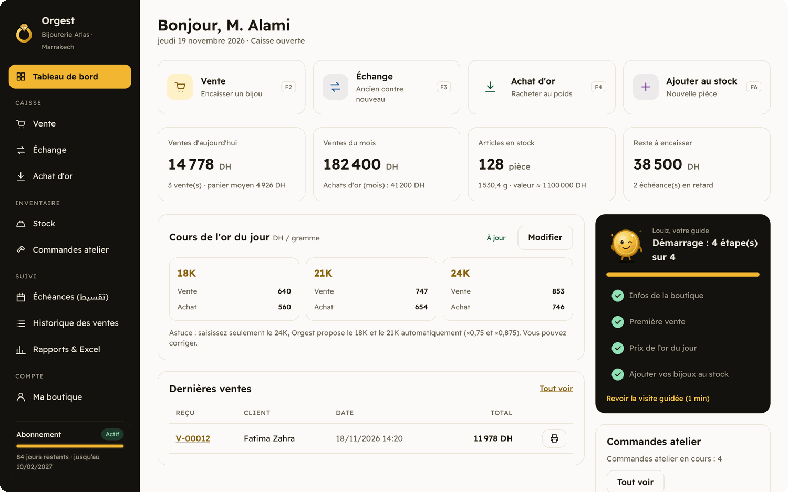</p>

---

## 📸 Screenshots · Captures d'écran

> Demo data and illustrated product photos. · Données de démonstration et photos de produits illustrées.

<table>
  <tr>
    <td width="50%">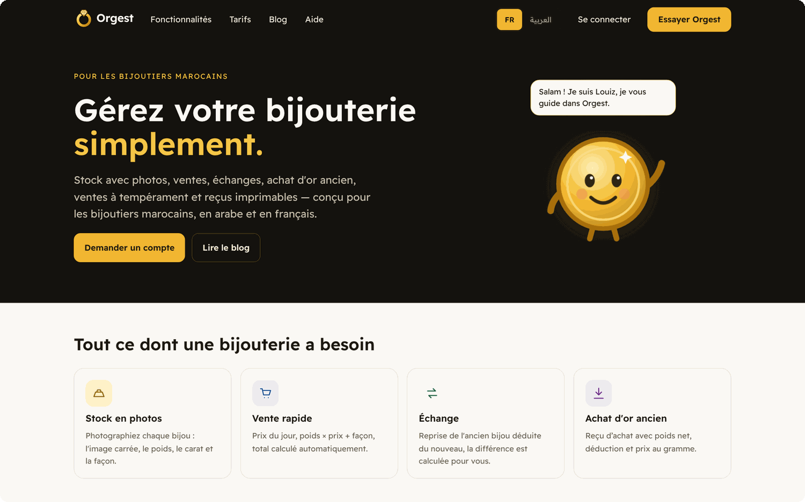<br><b>Public site</b> — FR / AR, SEO blog, live pricing plans<br><sub>Site public — FR / AR, blog SEO, tarifs dynamiques</sub></td>
    <td width="50%">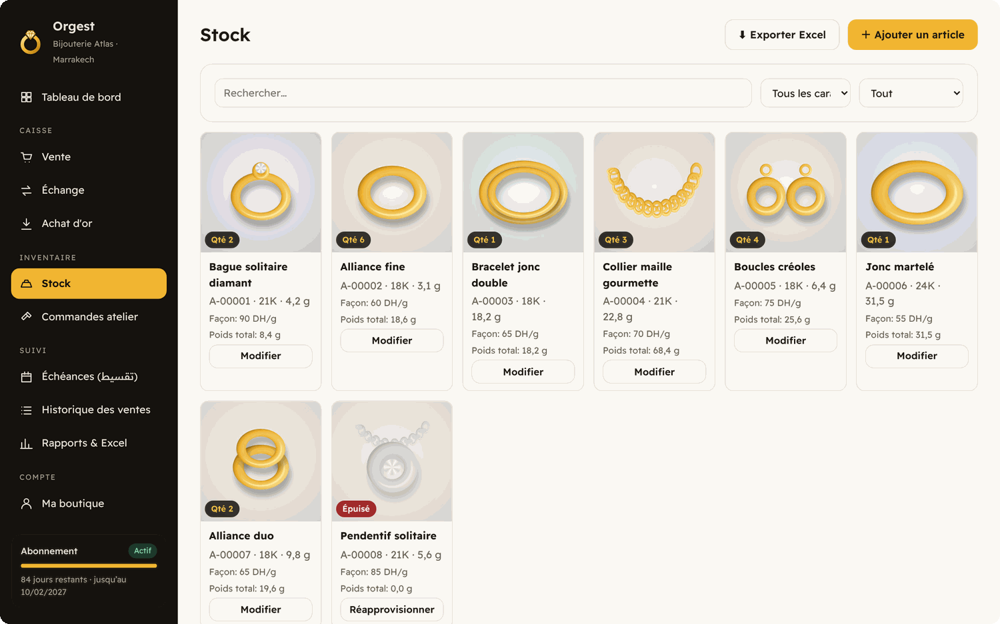<br><b>Stock with photos &amp; quantities</b> — sold-out items stay visible, never deleted<br><sub>Stock avec photos et quantités — les articles épuisés restent affichés</sub></td>
  </tr>
  <tr>
    <td width="50%">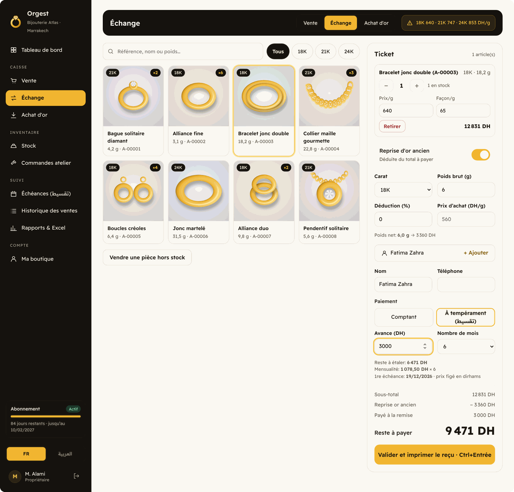<br><b>Exchange + installments (تقسيط)</b> — trade-in value, down payment, exact schedule<br><sub>Échange + vente à tempérament — reprise, avance, échéancier exact</sub></td>
    <td width="50%">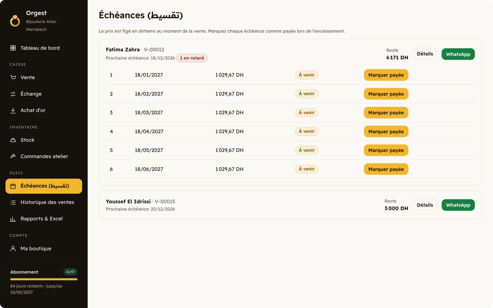<br><b>Installments tracking</b> — due dates, late flags, WhatsApp reminders<br><sub>Suivi des échéances — retards et rappel WhatsApp</sub></td>
  </tr>
  <tr>
    <td width="50%">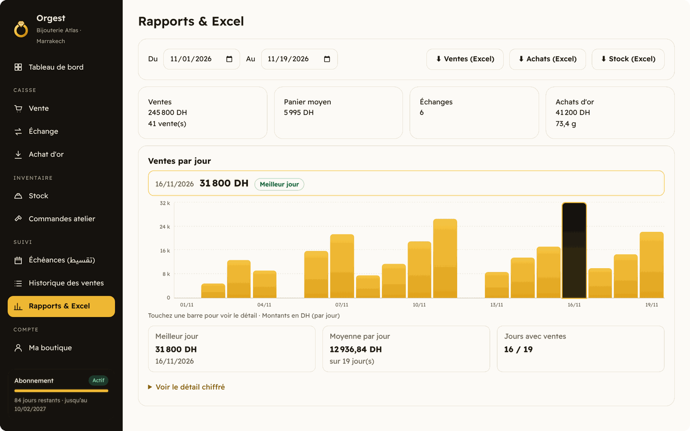<br><b>Readable sales chart</b> — axes, tap-to-read, best day, Excel export<br><sub>Graphique lisible — axes, valeur au toucher, meilleur jour, export Excel</sub></td>
    <td width="50%">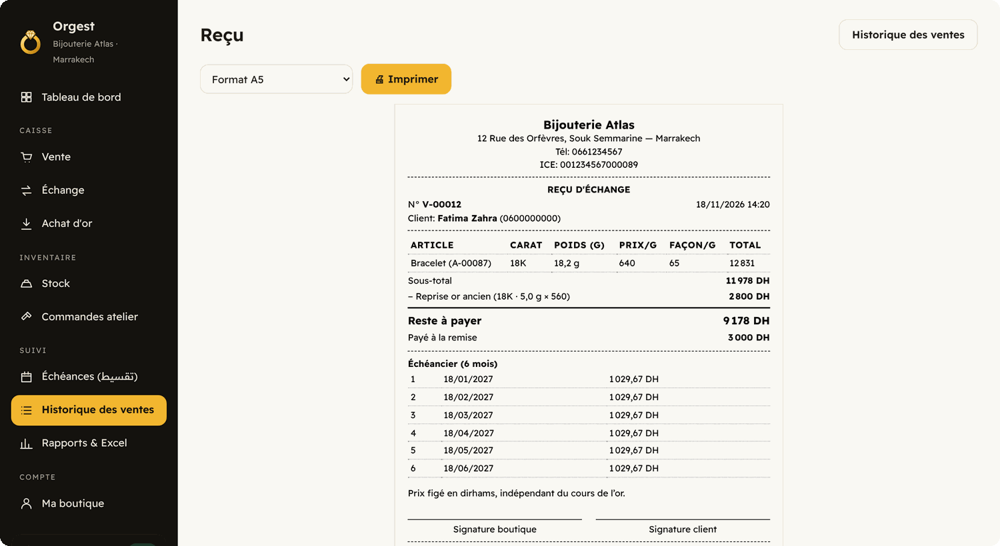<br><b>Printable receipts</b> — A5 or 80 mm thermal ticket<br><sub>Reçus imprimables — A5 ou ticket thermique 80 mm</sub></td>
  </tr>
  <tr>
    <td width="50%">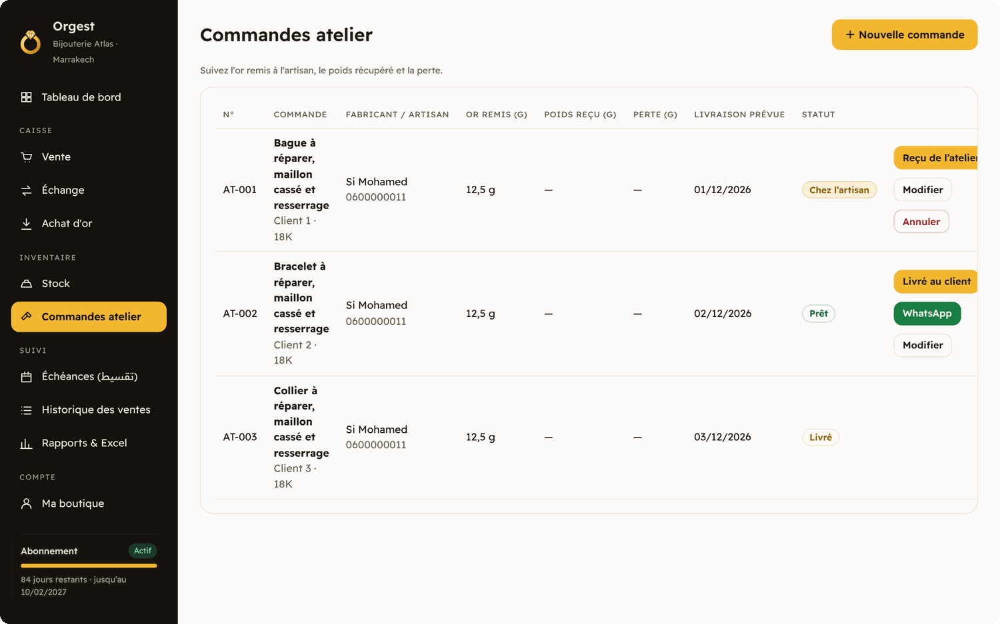<br><b>Workshop orders</b> — gold given to the artisan, weight received, loss<br><sub>Commandes atelier — or remis, poids reçu, perte</sub></td>
    <td width="50%">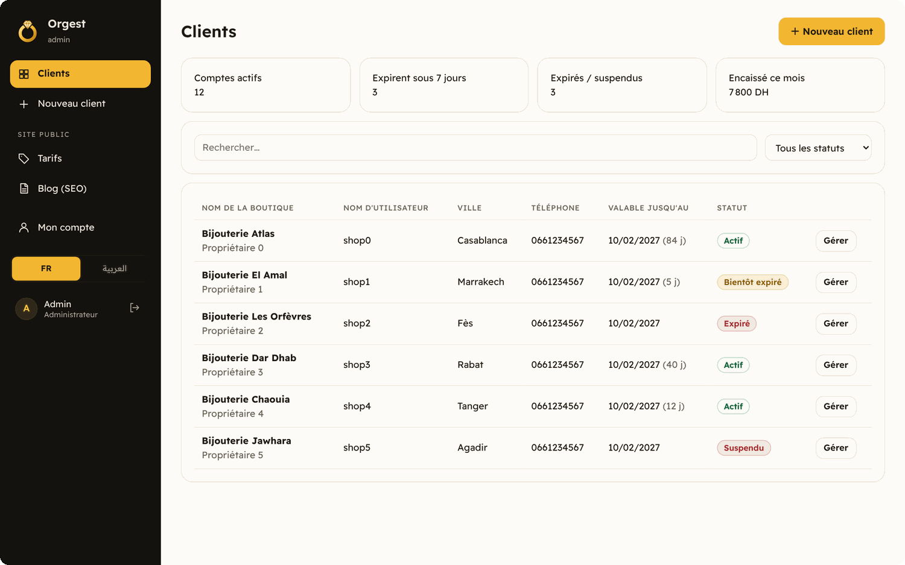<br><b>Admin panel</b> — shop accounts, subscriptions, plans, blog<br><sub>Panneau administrateur — comptes, abonnements, tarifs, blog</sub></td>
  </tr>
  <tr>
    <td width="50%">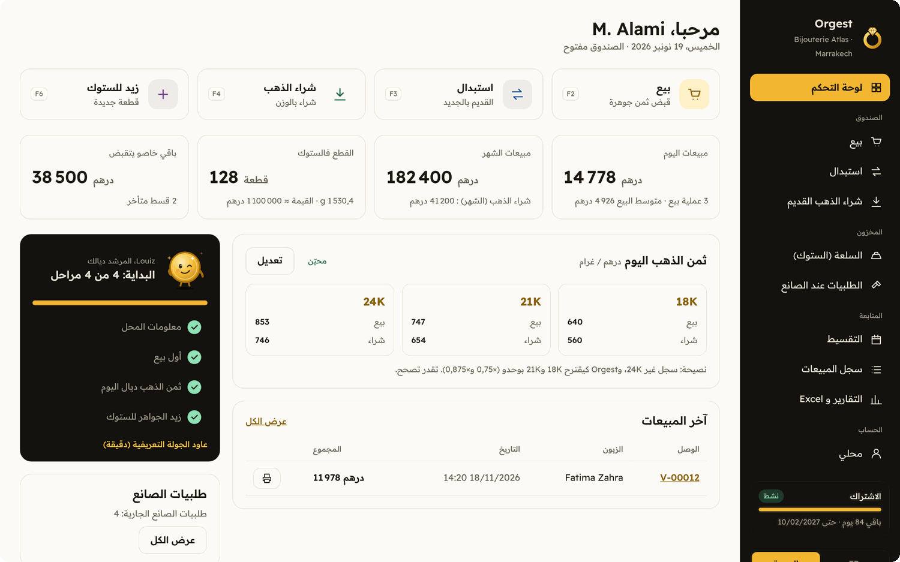<br><b>Arabic, right-to-left</b> — full RTL interface<br><sub>Arabe, de droite à gauche — interface RTL complète</sub></td>
    <td width="50%">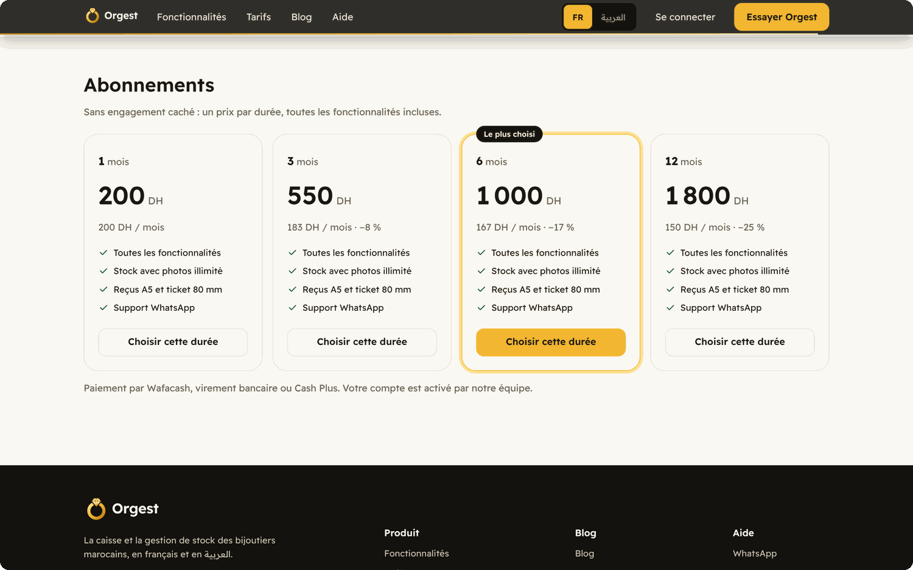<br><b>Subscription plans</b> — 1 / 3 / 6 / 12 months, editable by the admin<br><sub>Abonnements — 1 / 3 / 6 / 12 mois, modifiables par l'admin</sub></td>
  </tr>
</table>

<p align="center">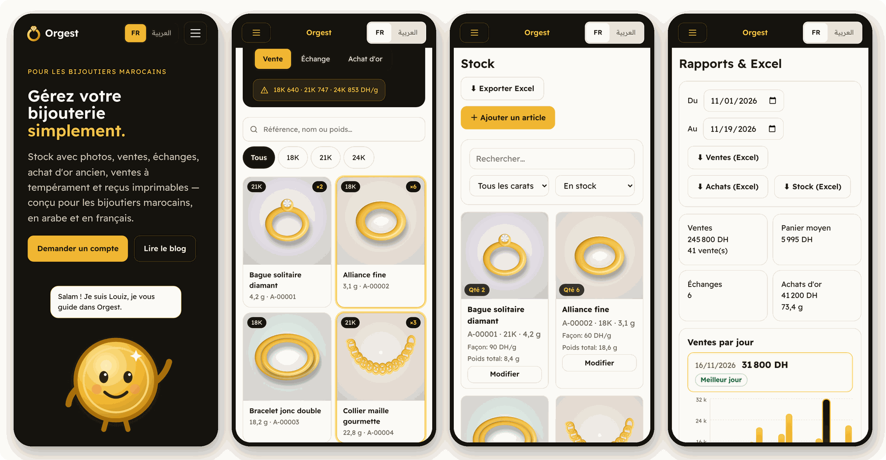<br><b>Built for phones</b> — burger menu, table→cards, sticky ticket bar · <sub>Pensé pour le téléphone</sub></p>

---

## 🇬🇧 English

### What is Orgest?

Orgest is a multi-tenant web SaaS that runs the daily work of a Moroccan jewellery shop: **stock with photos**, **sales**, **gold exchange**, **old-gold buy-back**, **workshop orders**, **installment sales (تقسيط)**, printable receipts, reports and Excel exports — in **French and Arabic (RTL)**, on desktop and phone. A built-in **admin panel** manages shop accounts and subscriptions (payment happens off-platform: Wafacash, bank transfer, Cash Plus).

### Features

| | |
|---|---|
| 📦 **Stock** | Square photos, karat (18/21/24), unit weight, making charge per gram and **quantity per item**. Selling decreases the quantity; at 0 the item stays in the catalogue as *sold out* (with its photo) and can be restocked. Items that were ever sold can never be deleted. |
| 🛒 **Sale & exchange** | Daily gold price × weight + making charge; quantity stepper per line; exchange = trade-in of old gold (deduction %, buy price) with amount to pay **or to refund**. |
| 🪙 **Gold buy-back** | Gross/net weight, deduction, price per gram, printable receipt. |
| 📅 **Installments (تقسيط)** | Price frozen in dirhams, down payment, 1–36 monthly terms **split to the cent** (the sum is always exact), late tracking, WhatsApp reminders. |
| 🔨 **Workshop** | Orders to artisans: gold given, weight received, loss, deposit, due date, status flow. |
| 🧾 **Receipts** | A5 and 80 mm thermal layouts, shop header (ICE, address), signatures, installment schedule. |
| 📊 **Reports** | Readable sales chart (day / week / month grouping), best day, averages, Excel exports with formula-injection protection. |
| 🛡️ **Admin** | Create shop accounts with generated passwords, renew 1/3/6/12 months, suspend, payment history, **editable pricing plans**, **SEO blog editor**. Expired accounts lose data access. |
| 🌍 **UI** | FR / AR with RTL, responsive phone layout, guided tour by the mascot *Louiz*, smooth motion (respects *reduced motion*). |
| 📱 **PWA & offline** | Installable app. Stock, prices and profile are cached on the device; sales made without a connection are queued in IndexedDB and synced automatically (idempotent `clientRef`, conflicts shown in a banner). |
| 🔎 **Scan checkout** | USB barcode scanner (types the reference + Enter) or phone camera (`BarcodeDetector`) adds the item to the sale. |
| 🏷️ **Labels** | Code 128 barcodes (own encoder, cross-checked against a reference implementation) on an A4 3×8 sheet or a 50×25 mm roll; shop logo on receipts; A4 voucher format. |
| 💳 **Payments & credit** | Cash, cheque, card, transfer or **customer credit** (optional advance); customer book; settlements are applied oldest-first and over-payment is refused; "credits to collect" on the dashboard. |
| 🥈 **Silver** | Ag 800 / 925 / 999 next to gold 18/21/24 (prices, stock, sales, buy-back, workshop); weights switch to kg above 1 000 g. |
| 👥 **Team** | One account per employee (`shop.code`): sells, exchanges, buys back and follows installments; prices, stock edits, dashboard, reports, exports, account and team are owner-only (enforced server-side). |
| 🔔 **Push** | A Web Push notification on every sale for the owner's devices (RFC 8291 + VAPID implemented without third-party libraries; endpoints restricted to browser push services). |
| 🔐 **Security** | JWT in HttpOnly cookie + CSRF, BCrypt, lockout &amp; rate limiting, per-shop data isolation, audit log — see the OWASP table below. |

### Tech stack

| Layer | Technology |
|---|---|
| Backend | Spring Boot 4.1 (Java 21), Spring Security, JPA/Hibernate, Flyway |
| Database | PostgreSQL |
| API | REST JSON (`/api/**`) |
| Frontend | React 19 + Vite, react-router, custom i18n (FR/AR), no UI framework |
| Deployment | Ubuntu + aaPanel (Nginx) + systemd via `deploy.sh`, or Docker Compose |
| CI/CD | GitHub Actions: `mvn verify` + `npm test` + build → SSH forced-command deploy |
| Tests | JUnit 5 + Mockito (backend) · Vitest (calculations, i18n parity, error codes) |

### Quick start (development)

```bash
# backend (local PostgreSQL required)
cd backend && export $(grep -v '^#' ../.env.example | xargs) && mvn spring-boot:run

# frontend (proxies /api → :8080)
cd frontend && npm install && npm run dev
```

Docker: `cp .env.docker.example .env && nano .env && docker compose up -d --build` (site on `127.0.0.1:8088`, put it behind your HTTPS proxy).

### Deployment (Ubuntu VPS + aaPanel)

```bash
git clone https://github.com/elguennouni-dev/Orgest.git && cd Orgest
sudo ./deploy.sh app.your-domain.ma --whatsapp 212612345678
```

`deploy.sh` installs Java 21 / Maven / Node 22 / PostgreSQL if missing, creates a dedicated DB user with a random password, builds backend + frontend, installs a hardened non-root `orgest` systemd service, writes the Nginx rewrite rules for the aaPanel site (API proxy, SPA, security headers) and schedules a daily backup (14 days). The admin login is printed **once**.
**Automatic deploys:** `sudo ./tools/setup-ci-deploy.sh your-domain 2126…` prints 4 values to store as GitHub *Secrets* (`VPS_HOST`, `VPS_USER`, `VPS_KNOWN_HOSTS`, `VPS_SSH_KEY`); every push to `main` is tested, built and deployed. The SSH key can only run `orgest-deploy`.

**Demo data:** `sudo python3 tools/seed_demo.py https://your-domain` creates a `demo` shop with items + photos, sales, exchanges, buy-backs, installments and workshop orders.

### SEO & discoverability

The public pages (`/`, `/blog`, `/blog/<slug>`) are **rendered by the backend** into the built `index.html`: title, meta description, canonical, Open Graph, JSON-LD (Organization, WebSite, SoftwareApplication, FAQPage, Article, BreadcrumbList) and crawlable content — no JavaScript needed. Everything else is generated from the database, so nothing goes stale:

| URL | Purpose |
| --- | --- |
| `/sitemap.xml` | every published article, with `lastmod` — updates itself when you publish |
| `/robots.txt` | blocks `/app`, `/admin`, `/login`, `/api/`; allows search and AI crawlers |
| `/llms.txt`, `/llms-full.txt` | summary + full text of the site for AI assistants |
| `/feed.xml` | RSS feed of the blog |

Private areas also send `X-Robots-Tag: noindex`. Unknown slugs return a real **404**. Publish from **Admin → Blog**; the editor shows a Google preview and an SEO checklist.

### Testing

```bash
cd frontend && npm test      # Vitest: money rules, installment schedule, chart helpers, FR/AR parity, backend error codes
cd backend  && mvn verify    # JUnit/Mockito: sales, stock quantities, installments, workshop, prices, reports
```

The same worked examples are asserted in Java **and** JavaScript, so the screen always shows exactly what the server will record.

### Security (OWASP Top 10 – 2021)

| # | Risk | Measures in Orgest |
|---|---|---|
| A01 | Broken access control | `ADMIN`/`SHOP` roles per URL, **per-shop isolation** on every query (shop id comes from the session, never from the client), deny-by-default, photos via authenticated endpoint, pessimistic lock against double selling |
| A02 | Cryptographic failures | BCrypt (cost 12), HS256 JWT with ≥ 32-char secret from the environment, `HttpOnly; Secure; SameSite=Strict` cookie, HSTS |
| A03 | Injection | Parameterised JPA/JPQL only, Bean Validation on every DTO, Excel formula-injection guard, React escaping |
| A04 | Insecure design | Dedicated DTOs, amounts **recomputed server-side**, atomic numbering, validated and re-encoded image uploads, pagination/range limits |
| A05 | Misconfiguration | CSP / X-Frame-Options / Referrer-Policy headers, no stack traces, actuator off, backend bound to `127.0.0.1`, hardened systemd unit |
| A06 | Vulnerable components | Spring Boot BOM, `mvn -Psecurity verify` (dependency-check), `npm audit` |
| A07 | Authentication failures | Lockout after 5 failures (15 min), per-IP limiter, constant-time compare, password policy, session invalidation (`tokenVersion`), 12 h JWT |
| A08 | Integrity | Signed JWT, no untrusted deserialisation, `npm ci`, versioned Flyway migrations |
| A09 | Logging | Database audit trail (logins, lockouts, admin actions, password changes) with log-injection cleaning |
| A10 | SSRF | No outbound call is triggered by user input |

CSRF: double-submit `XSRF-TOKEN` cookie + `X-XSRF-TOKEN` header on every non-GET request, on top of `SameSite=Strict`.

API exposure: the backend listens on `127.0.0.1` only, so it is reachable solely through the frontend's Nginx. On top of that, `ApiGuardFilter` answers **404** to any `/api/**` call that is not made by our own frontend (typed URL, other site, missing `X-Orgest-Client` header); images, SEO pages and crawler files stay public. This is a guard against curiosity — data protection still rests on authentication and CSRF.

### Project structure

```
backend/    Spring Boot (API, security, JPA, Flyway migrations, tests)
frontend/   React + Vite (landing, blog, login, shop app, admin) + Vitest tests
docs/       Screenshots
tools/      CI-deploy setup, demo seed
deploy.sh   Ubuntu + aaPanel deployment
```

---

## 🇫🇷 Français

### Qu'est-ce qu'Orgest ?

Orgest est un SaaS web multi-boutiques qui gère le quotidien d'une bijouterie marocaine : **stock avec photos**, **ventes**, **échange**, **achat d'or ancien**, **commandes chez le fabricant**, **vente à tempérament (تقسيط)**, reçus imprimables, rapports et exports Excel — en **français et en arabe (RTL)**, sur ordinateur comme sur téléphone. Un **panneau administrateur** gère les comptes et abonnements (paiement hors plateforme : Wafacash, virement bancaire, Cash Plus).

### Fonctionnalités

| | |
|---|---|
| 📦 **Stock** | Photos carrées, carat (18/21/24), poids unitaire, façon au gramme et **quantité par article**. Chaque vente diminue la quantité ; à 0 l'article reste au catalogue comme *épuisé* (avec sa photo) et peut être réapprovisionné. Un article déjà vendu ne peut jamais être supprimé. |
| 🛒 **Vente & échange** | Prix de l'or du jour × poids + façon ; quantité par ligne ; échange = reprise de l'ancien (déduction %, prix d'achat) avec montant à payer **ou à rendre**. |
| 🪙 **Achat d'or** | Poids brut/net, déduction, prix au gramme, reçu imprimable. |
| 📅 **Tempérament (تقسيط)** | Prix figé en dirhams, avance, 1 à 36 mensualités **réparties au centime près** (somme toujours exacte), suivi des retards, rappel WhatsApp. |
| 🔨 **Atelier** | Commandes aux artisans : or remis, poids reçu, perte, acompte, livraison, statuts. |
| 🧾 **Reçus** | Formats A5 et ticket thermique 80 mm, en-tête boutique (ICE, adresse), signatures, échéancier. |
| 📊 **Rapports** | Graphique lisible (regroupement jour / semaine / mois), meilleur jour, moyennes, exports Excel protégés contre l'injection de formules. |
| 🛡️ **Admin** | Création des comptes (mot de passe généré), renouvellement 1/3/6/12 mois, suspension, historique des paiements, **tarifs modifiables**, **éditeur de blog SEO**. Un compte expiré n'accède plus aux données. |
| 🌍 **Interface** | FR / AR avec RTL, mise en page mobile, visite guidée par la mascotte *Louiz*, animations douces (respecte *réduire les animations*). |
| 📱 **PWA & hors ligne** | Application installable. Stock, prix et profil sont mis en cache ; les ventes faites sans connexion sont gardées dans IndexedDB puis synchronisées automatiquement (`clientRef` idempotent, conflits signalés dans un bandeau). |
| 🔎 **Caisse par scan** | Lecteur USB (tape la référence + Entrée) ou caméra du téléphone (`BarcodeDetector`) : l'article est ajouté à la vente. |
| 🏷️ **Étiquettes** | Codes-barres Code 128 (encodeur maison, vérifié contre une implémentation de référence) en planche A4 3×8 ou rouleau 50×25 mm ; logo de la boutique sur les reçus ; format bon A4. |
| 💳 **Paiements & crédit** | Espèces, chèque, carte, virement ou **crédit client** (avance possible) ; carnet clients ; règlements imputés du plus ancien au plus récent, trop-perçu refusé ; « crédits à encaisser » au tableau de bord. |
| 🥈 **Argent** | Ag 800 / 925 / 999 à côté de l'or 18/21/24 (prix, stock, ventes, rachat, atelier) ; poids en kg au-delà de 1 000 g. |
| 👥 **Équipe** | Un compte par employé (`boutique.code`) : vend, échange, rachète et suit les échéances ; prix, modification du stock, tableau de bord, rapports, exports, compte et équipe réservés au propriétaire (contrôlé côté serveur). |
| 🔔 **Notifications** | Notification Web Push à chaque vente sur les appareils du propriétaire (RFC 8291 + VAPID sans bibliothèque tierce ; points d'accès limités aux services push des navigateurs). |
| 🔐 **Sécurité** | JWT en cookie HttpOnly + CSRF, BCrypt, verrouillage et limitation, isolation des données par boutique, journal d'audit — voir le tableau OWASP ci-dessous. |

### Technologies

| Couche | Technologie |
|---|---|
| Backend | Spring Boot 4.1 (Java 21), Spring Security, JPA/Hibernate, Flyway |
| Base de données | PostgreSQL |
| API | REST JSON (`/api/**`) |
| Frontend | React 19 + Vite, i18n AR/FR maison, sans framework UI |
| Déploiement | Ubuntu + aaPanel (Nginx) + systemd via `deploy.sh`, ou Docker Compose |
| CI/CD | GitHub Actions : `mvn verify` + `npm test` + build → déploiement SSH à commande forcée |
| Tests | JUnit 5 + Mockito (backend) · Vitest (calculs, parité i18n, codes d'erreur) |

### Développement local

```bash
# backend (PostgreSQL local requis)
cd backend && export $(grep -v '^#' ../.env.example | xargs) && mvn spring-boot:run
# frontend (proxy /api → :8080)
cd frontend && npm install && npm run dev
```

### Déploiement (VPS Ubuntu + aaPanel)

1. Dans aaPanel : **Website → Add site** pour votre domaine (site statique), puis **SSL → Let's Encrypt** (+ *Force HTTPS*).
2. Sur le VPS :
   ```bash
   git clone https://github.com/elguennouni-dev/Orgest.git && cd Orgest
   sudo ./deploy.sh app.votre-domaine.ma --whatsapp 212612345678
   ```
3. Le script affiche **une seule fois** l'identifiant et le mot de passe de l'administrateur. Connectez-vous sur
   `https://app.votre-domaine.ma/login` puis changez le mot de passe (*Mon compte*).
4. **Mises à jour** : `git pull && sudo ./deploy.sh app.votre-domaine.ma` (les secrets et la base sont conservés).

Ce que fait `deploy.sh` : installe Java 21 / Maven / Node 22 / PostgreSQL si absents, crée la base et un utilisateur
dédié (mot de passe aléatoire), compile backend + frontend, installe le service `orgest` (utilisateur non-root, durci),
écrit la config Nginx dans le « rewrite » du site aaPanel (proxy `/api`, SPA, en-têtes de sécurité) et planifie une
sauvegarde quotidienne (`/var/backups/orgest`, 14 jours).

Base PostgreSQL créée par aaPanel ? `DB_MODE=external DB_URL=jdbc:postgresql://127.0.0.1:5432/ma_base DB_USER=… DB_PASSWORD=… sudo -E ./deploy.sh domaine`.

Commandes utiles : `journalctl -u orgest -f` · `systemctl restart orgest` · `/usr/local/sbin/orgest-backup`.

### Domaine, déploiement automatique et Docker

**Nouveau domaine (ex. `orgest.tech`)** : DNS → enregistrement A vers l'IP du VPS · aaPanel > Website > Add site (statique) > SSL Let's Encrypt + Force HTTPS · puis
`cd /opt/orgest-src && git pull && sudo ./deploy.sh orgest.tech --whatsapp 212680376294`.

**Déploiement automatique (GitHub Actions)** : sur le VPS `sudo ./tools/setup-ci-deploy.sh orgest.tech 212680376294`, puis copier les 4 valeurs affichées dans GitHub > Settings > Secrets and variables > Actions (`VPS_HOST`, `VPS_USER`, `VPS_KNOWN_HOSTS`, `VPS_SSH_KEY`). Chaque push sur `main` compile/teste puis déploie. La clé SSH ne peut exécuter que `orgest-deploy`.

**Docker (alternative)** : `cp .env.docker.example .env && nano .env && docker compose up -d --build` ; le site écoute sur `127.0.0.1:8088` (à mettre derrière le proxy HTTPS d'aaPanel). Ne pas lancer en même temps que le déploiement systemd sur le même domaine.

**Données de démo :** `sudo python3 tools/seed_demo.py https://votre-domaine` crée la boutique `demo` (articles + photos, ventes, échanges, achats, échéances, atelier).

### SEO et référencement

Les pages publiques (`/`, `/blog`, `/blog/<slug>`) sont **rendues par le backend** dans le `index.html` compilé : title, meta description, canonical, Open Graph, JSON-LD (Organization, WebSite, SoftwareApplication, FAQPage, Article, BreadcrumbList) et contenu lisible sans JavaScript. Le reste est généré depuis la base, donc toujours à jour : `/sitemap.xml` (se met à jour à chaque publication), `/robots.txt` (bloque `/app`, `/admin`, `/login`, `/api/`), `/llms.txt` et `/llms-full.txt` (pour les assistants IA) et `/feed.xml` (RSS). Les espaces privés envoient `X-Robots-Tag: noindex` et un slug inconnu renvoie un vrai **404**. Publiez depuis **Admin → Blog** : l'éditeur affiche l'aperçu Google et une checklist SEO.

### Tests

```bash
cd frontend && npm test      # Vitest : règles monétaires, échéancier, graphique, parité FR/AR, codes d'erreur
cd backend  && mvn verify    # JUnit/Mockito : ventes, quantités de stock, tempérament, atelier, prix, rapports
```

Les mêmes cas chiffrés sont testés en Java **et** en JavaScript : l'écran affiche exactement ce que le serveur enregistrera.

### Sécurité — OWASP Top 10 (2021)

| # | Risque | Mesures dans Orgest |
|---|---|---|
| A01 | Broken Access Control | Rôles `ADMIN`/`SHOP` par URL (`/api/admin/**`, `/api/shop/**`), **isolation par commerçant** : chaque requête SQL filtre sur l'identifiant du commerçant authentifié (jamais fourni par le client), `denyAll` par défaut, photos servies uniquement via endpoint authentifié, verrou pessimiste anti double-vente |
| A02 | Cryptographic Failures | BCrypt (coût 12), JWT HS256 avec secret ≥ 32 car. fourni par l'environnement, cookie `HttpOnly; Secure; SameSite=Strict`, HSTS, secrets hors du code (`/etc/orgest/orgest.env`, chmod 640) |
| A03 | Injection | Requêtes JPA/JPQL paramétrées uniquement, validation Bean Validation sur tous les DTO, aucune concaténation SQL, **protection contre l'injection de formules** dans les exports Excel, React échappe le HTML (aucun `dangerouslySetInnerHTML`) |
| A04 | Insecure Design | DTO dédiés (pas de mass assignment), montants recalculés **côté serveur**, numérotation atomique, upload d'images validé (signature, taille, pixels) et **ré-encodé** en JPEG, limites de pagination et de période |
| A05 | Security Misconfiguration | En-têtes CSP / X-Content-Type-Options / X-Frame-Options / Referrer-Policy / Permissions-Policy (Nginx + Spring), pas de stack-trace ni de message d'erreur détaillé, actuator désactivé, backend lié à `127.0.0.1`, service systemd durci, `server_tokens off` |
| A06 | Vulnerable Components | Dépendances gérées par le BOM Spring Boot ; `mvn -Psecurity verify` (OWASP dependency-check) et `npm audit` ; versions à jour |
| A07 | Identification & Auth Failures | Verrouillage après 5 échecs (15 min), limiteur par IP, comparaison à temps constant (hash factice), messages génériques, politique de mot de passe, **invalidation des sessions** (`tokenVersion`) lors du changement/réinitialisation du mot de passe ou de la suspension, expiration JWT 12 h |
| A08 | Software & Data Integrity | JWT signé et vérifié, pas de désérialisation non fiable, build reproductible (`npm ci`, Maven), migrations Flyway versionnées |
| A09 | Logging & Monitoring | Journal d'audit en base (connexions réussies/échouées, verrouillages, actions admin, changements de mot de passe) avec nettoyage anti log-injection ; logs systemd |
| A10 | SSRF | Aucun appel sortant déclenché par une entrée utilisateur (les liens WhatsApp sont construits côté navigateur) |

CSRF : cookie `XSRF-TOKEN` (double-submit) + en-tête `X-XSRF-TOKEN` obligatoire sur toute requête non-GET, en plus de `SameSite=Strict`.

### Configuration

| Variable | Rôle |
|---|---|
| `DB_URL`, `DB_USER`, `DB_PASSWORD` | Connexion PostgreSQL |
| `JWT_SECRET` | Clé de signature (≥ 32 caractères) |
| `COOKIE_SECURE` | `true` en HTTPS (défaut) |
| `UPLOAD_DIR` | Dossier des photos (hors racine web) |
| `ORGEST_ADMIN_USERNAME` / `ORGEST_ADMIN_PASSWORD` | Création du premier admin si aucun n'existe (≥ 12 car.) |
| `VITE_WHATSAPP` | Numéro WhatsApp de la page d'accueil (build du frontend) |

### Structure

```
backend/    Spring Boot (API, sécurité, JPA, migrations Flyway, tests)
frontend/   React + Vite (accueil, blog, connexion, app commerçant, admin) + tests Vitest
docs/       Captures d'écran
tools/      Installation du déploiement CI, données de démo
deploy.sh   Déploiement Ubuntu + aaPanel
```

---

<p align="center"><sub>Made in Morocco 🇲🇦 for jewellers · Conçu au Maroc pour les bijoutiers — <a href="https://orgest.tech">orgest.tech</a></sub></p>
